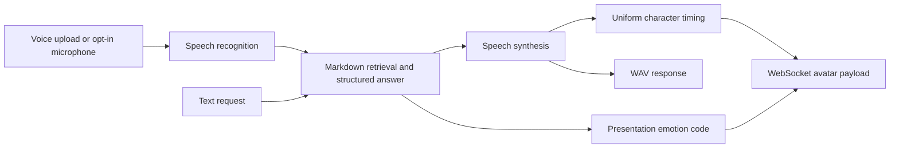

# Speech Avatar Bridge

A Python integration layer connecting speech recognition, source-grounded dialogue, speech synthesis, and an animated avatar viewer. It exposes a FastAPI control plane, broadcasts animation messages over a loopback WebSocket, and provides an optional Telegram transport.

The repository focuses on the orchestration and avatar protocol. It includes a neutral Markdown retrieval example, structured presentation hints, bounded microphone capture, and an offline protocol demo. It does not distribute a rendered avatar, an Unreal project, private voices, customer knowledge, personal identity profiles, pretrained weights, or credentials.

## End-to-end flow



| Module | Role |
| --- | --- |
| `fastapi/main.py` | HTTP routes, WebSocket lifecycle, optional microphone and SpeechKit orchestration |
| `fastapi/chunks.py` | Markdown chunking, in-memory FAISS retrieval, source-grounded prompts, structured response validation |
| `fastapi/protocol.py` | Character marker formatting, animation/emotion codes, disconnect-safe broadcasting |
| `fastapi/mappings.py` | Stable numeric character, animation, and emotion mappings |
| `fastapi/phonemes.py` | Historical helper API; optional recognition is deferred until explicitly requested |
| `bot.py` | Optional allowlisted Telegram transport; no persisted conversation export |
| `start.py` | Explicit API launcher, optional bot subprocess, process cleanup |
| `examples/` | Fictional knowledge and generic English system instructions |

The historical wire field `phonemes` contains **character-based markers**. Timing is uniformly distributed over the synthesized audio duration. It is not acoustic phoneme extraction, forced alignment, or a validated lip-sync model. Unknown characters use code 0. The Cyrillic alphabet mapping remains because it is protocol data, while operational documentation is in English.

## Run without providers or credentials

Use Python 3.11 or 3.12 in a dedicated virtual environment:

```bash
python -m venv .venv
```

Activate with `source .venv/bin/activate` on Linux/macOS or `.\.venv\Scripts\Activate.ps1` in PowerShell. Then:

```bash
python -m pip install -r requirements-checks.txt
python offline_demo.py
python -m unittest discover -s tests -v
python start.py
```

The offline demo prints a synthetic JSON payload. It does not open a socket, download a model, call a provider, or capture audio. Starting the API is a separate explicit action: HTTP listens on `127.0.0.1:8000` and the avatar WebSocket on `127.0.0.1:9999`.

```bash
curl http://127.0.0.1:8000/health
curl -X POST http://127.0.0.1:8000/api/set_anim_state -H "Content-Type: application/json" -d '{"anim_state":"talk"}'
```

The animation response is `{"anim_state":6}`. Provider-backed routes return HTTP 503 until explicitly enabled. A WebSocket client can send `{"action":"a_input","value":1}` only after microphone capture and providers have both been enabled by the local operator. The compatibility action `usr_key` always selects the same generic profile; it cannot activate a personal persona.

## Optional provider integration

`requirements-providers.txt` lists the separate OpenAI/LangChain/FAISS and SpeechKit integration dependencies. They are not required for offline checks. The live pipeline retains the original provider families; its configured defaults are compatibility choices rather than a recommendation of a current model or a measured quality result.

Before running it, supply your own approved credentials through the process environment, choose permitted provider models, and set `AVATAR_ENABLE_PROVIDERS=1`. The application does not load old local `.env` files. Audio decoding/encoding additionally needs a system FFmpeg installation; microphone input needs the optional PyAudio package and a working device. These dependencies and real cloud operations are not exercised by CI.

| Variable | Purpose / default |
| --- | --- |
| `AVATAR_ENABLE_PROVIDERS` | `0`; no live provider operation by default |
| `AVATAR_ENABLE_MICROPHONE` | `0`; hardware capture requires explicit opt-in |
| `OPENAI_API_KEY` | Operator-supplied LLM/embedding credential |
| `OPENAI_CHAT_MODEL` | Historical chat default `gpt-4o-mini` |
| `OPENAI_EMBEDDING_MODEL` | Historical embedding default `text-embedding-3-large` |
| `SK_TOKEN`, `CATALOG_ID` | Operator-supplied SpeechKit OAuth token and folder identifier |
| `AVATAR_KNOWLEDGE_PATH` | Defaults to fictional `examples/knowledge.md` |
| `AVATAR_MAX_L2_DISTANCE` | Optional calibrated retrieval cutoff; unset includes top four matches |
| `AVATAR_VOICE` | Provider voice name; default `lera` |
| `AVATAR_WS_PORT` | `9999` |
| `AVATAR_CORS_ORIGINS` | Loopback browser origins; credentials disabled |
| `BOT_TOKEN`, `AVATAR_ALLOWED_USER_IDS` | Optional Telegram credential and comma-separated allowlist; empty denies access |

The retrieval index is built in memory from reviewed text on the first enabled request. No FAISS pickle/index is loaded from disk. A lower FAISS L2 distance indicates a closer result; an optional cutoff applies before context assembly. Reference material is labeled as untrusted data. Structured outputs are requested with a JSON schema and checked locally for allowed emotion labels, required fields, and an intensity in [0, 1]. Emotion is only an avatar presentation hint.

See the [OpenAI structured-output reference](https://developers.openai.com/api/docs/guides/structured-outputs?api-mode=chat) for the raw JSON-schema request format used by the optional adapter.

## HTTP and avatar contracts

| Interface | Input / result |
| --- | --- |
| `GET /health` | Process status, provider opt-in state, index initialization state |
| `POST /api/get_answer_async` | JSON `text`, optional `history`; structured answer plus `message` |
| `POST /api/recognize_and_synthesize` | Raw supported audio body, maximum 10 MiB; synthesized WAV and WebSocket animation broadcast |
| `POST /api/set_anim_state` | Known animation label; numeric state and broadcast |
| WebSocket outgoing | `phonemes` list of `code_start_end`, numeric `anim_state`, numeric `emotion_state` |

For example, the offline demo uses the text `Demo`, duration 1.2 seconds, and Happy presentation. Latin letters absent from the historical character map are encoded as 0. Integrating a different avatar rig requires an explicit mapping update rather than treating these codes as a universal viseme standard.

## Validation and boundaries

Nine offline tests cover empty/invalid timing inputs, duration coverage, Cyrillic mapping compatibility, emotion case handling, disconnected peers, retrieval distance direction, filtered context assembly, strict response validation, provider/microphone gates, generic profile behavior, and HTTP status contracts. They use no real microphone, cloud credentials, or model downloads. CI also compiles all included Python sources and scans source/history for embedded secrets.

Live provider compatibility, speech quality, latency, avatar synchronization, and prompt-injection resistance have not been validated by those tests. The bridge is single-process and local: audio operations are serialized and WebSocket messages are broadcast to connected viewers. There is no multi-user isolation, persistent session service, internet-facing authentication, or included viewer. Do not expose its loopback control interfaces directly to the internet.

## Privacy, provenance, and usage

The published snapshot replaces earlier identity-specific scenarios with a generic assistant and fictional knowledge. Recordings, private corpus/prompts, deployment files, user identifiers, vector indexes, generated SDK sources, bundled executables, and viewer builds stay outside Git. [SECURITY.md](SECURITY.md) describes the publication boundary and [operator-guide.md](operator-guide.md) describes the manual setup. Original contributions are source-visible for portfolio review under [LICENSE](LICENSE); third-party dependencies retain their own terms.
